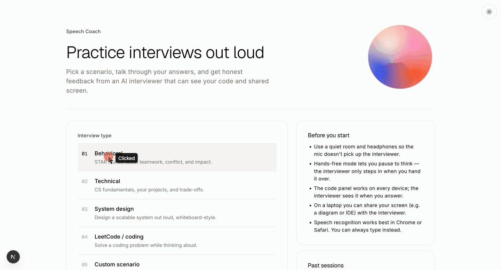

# Speech Coach 🎤

**Practice interviews out loud with an AI interviewer.** Pick a scenario, talk through your answers,
and get an honest feedback report at the end. The interviewer listens, replies out loud, and can see
your code and shared screen.



## Features
- **Five interview types:** behavioral, technical, system design, LeetCode / coding, or a custom
  scenario you describe.
- **Tailored to the job:** set the role, company, job description, difficulty, and length.
- **Two interviewer engines:**
  - **Gemini Live:** a real-time voice call. Pause to think, or talk over it to interrupt.
  - **Claude:** turn by turn. It sends your answer when you pause and speaks the reply.
- **It sees your work:** a built-in code panel on any device, plus screen sharing on a laptop.
- **Feedback report:** an overall score, category scores, strengths, things to improve, rewritten
  answers, words per minute, and a filler-word count.
- **Past sessions** saved in your browser, plus light and dark themes.

## Quick start
```bash
npm install
cp .env.example .env.local   # then add your keys
npm run dev
```
Open http://localhost:3000 in **Chrome** (best speech support) and allow the microphone.

## API keys
| Key | Needed? | What it does |
|---|---|---|
| `ANTHROPIC_API_KEY` | Required | Claude interviewer and the feedback report. Get one at https://console.anthropic.com |
| `GEMINI_API_KEY` | Optional | Turns on the Gemini Live real-time voice engine. Get one at https://aistudio.google.com/apikey |
| `GOOGLE_TTS_API_KEY` | Optional | A more natural cloud voice for the Claude engine. Without it, the free browser voice is used. |

**Cost:** the default Claude interviewer is Haiku 5.5, so a 30-minute mock costs a few cents. You
can pick Sonnet or Opus on the setup screen for a sharper interviewer.

## Use it on your phone
Deploy it for free on Vercel:
1. Go to vercel.com → **Add New → Project** → import `eelizabethho/speech-coach`.
2. Under **Environment Variables**, add your keys from the table above.
3. Deploy, then open the URL on your phone or laptop.

> ⚠️ Anyone with your deployment URL can use your API keys. Keep the URL private, or turn on
> Vercel password protection.

| Feature | Laptop (Chrome/Edge) | Android Chrome | iPhone Safari |
|---|---|---|---|
| Voice conversation | ✅ | ✅ | ✅ (tap Start first) |
| Screen sharing | ✅ | ❌ | ❌ |
| Code panel | ✅ | ✅ | ✅ |

## Tech stack
Next.js 15 · React 19 · TypeScript · Claude (`@anthropic-ai/sdk`) · Gemini Live (`@google/genai`) ·
Web Speech API

## Manual test checklist
- [ ] Start a behavioral interview and answer by voice. The interviewer replies out loud.
- [ ] Interrupt the interviewer while it's talking. It stops and listens.
- [ ] LeetCode mode: type code in the panel, then mention it. The interviewer refers to it.
- [ ] Laptop: share your screen and ask "what do you see?"
- [ ] End the interview and check that the feedback report and filler-word stats appear.
- [ ] The session shows up under Past sessions.

See [PLAN.md](PLAN.md) for the architecture and roadmap.
